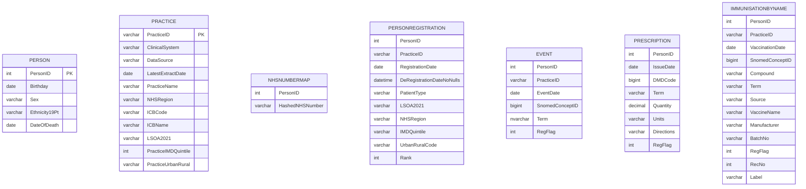

# Trial MSSD Schema Diagram

### Foreign-key targets
- NHSNUMBERMAP.PersonID -> PERSON.PersonID
- PERSONREGISTRATION.PersonID -> PERSON.PersonID
- PERSONREGISTRATION.PracticeID -> PRACTICE.PracticeID
- EVENT.PersonID -> PERSON.PersonID
- EVENT.PracticeID -> PRACTICE.PracticeID
- PRESCRIPTION.PersonID -> PERSON.PersonID
- IMMUNISATIONBYNAME.PersonID -> PERSON.PersonID
- IMMUNISATIONBYNAME.PracticeID -> PRACTICE.PracticeID

## Relationship summary

- A `Person` can have multiple `NHSNumberMap`, `PersonRegistration`, `Event`, `Prescription`, and `ImmunisationByName` records.
- A `Practice` can cover many `PersonRegistration`, and can be associated with many `Event` and `ImmunisationByName` rows.
- `PersonRegistration` links each person to the practice they were registered with at a given time.
- `Event` and `ImmunisationByName` are practice- and person-linked clinical observations.
- `Prescription` is linked to the person who received the prescription, without a direct `PracticeID` in the current schema.
